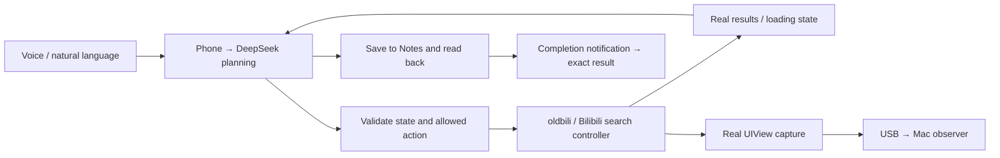

  
  &nbsp;
  

  

<h1 align="center">Cophone</h1>

<strong>Keep using your phone. Let your assistant get things done.</strong>

iPhone 4 · iOS 6.1.3 · Independent on-device networking · DeepSeek &amp; Qwen

cophone is a phone agent for a jailbroken iPhone 4. While you browse, scroll, or type in Safari, it searches Bilibili videos through **oldbili, a third-party Bilibili client for older iOS versions**. It operates inside the real app process, reads candidate information, compares videos, and saves its recommendation to your own system Notes app. It can also turn selected webpage text into a summary or an illustration. The phone sends AI requests directly; a Mac is used for deployment and optional execution observation.

**Why iPhone 4?**

iPhone 4 has always been my favorite phone. Its size, feel, and comfortable one-handed operation make it a small tool I enjoy carrying. I also love the care in iOS 6's skeuomorphic design: materials, light, and button details give its digital tools a familiar texture and warmth. Today's large, heavy phones do not appeal to me as much. I wanted this old favorite to keep doing new things.

With cophone, I also wanted to pay tribute to the product spirit of the Steve Jobs era and the vision of a Siri-like assistant: hold Home, say what you need, and let an assistant understand your intent, decide what to do from the actual state, and bring back a finished result. **I keep using my phone while it works for me.** In my own sentimental reading, this continues an “unfinished wish” I associate with Jobs: a pocket-sized device that understands people and can act on their behalf. cophone is my small step toward that wish, on a phone I love.

| You ask | cophone delivers |
| --- | --- |
| **Hold Home and speak** | Searches Bilibili in natural language, makes decisions from real results, and saves a comparison to Notes. |
| **Select text in Safari** | Confirm “整理成摘要” (summarize) or “整理成图片” (illustrate) in the selection menu; output goes to Notes or the cophone photo album. |
| **Start 目视官 (Observer)** | Groups app usage, available webpage excerpts, and video information by app into a recap note. |
| **Keep using your phone** | Sends a completion notification that opens the specific note or photo directly; the destination app receives the badge. |

**App screenshots**

Real screenshots of cophone 0.10.0 on iPhone 4 / iOS 6.1.3. The app interface and the linked detailed guides are currently in Chinese.

<table>
  <tr>
    <td align="center"><strong>Home</strong></td>
    <td align="center"><strong>History</strong></td>
    <td align="center"><strong>Settings</strong></td>
  </tr>
  <tr>
    <td></td>
    <td></td>
    <td></td>
  </tr>
</table>

**Quick setup**

1. **Required device: a jailbroken iPhone 4 running iOS 6.1.3.** Prepare Cydia Substrate, AppSync, OpenSSH, and working Wi-Fi. For video tasks, install oldbili **2.0.6 / net.iosipa.oldbili** separately.
2. Install `artifacts/ios6/cophone-iOS6-0.10.0-shipping.ipa` using i4Tools (爱思助手) or iFunBox. On the Mac, prepare Python 3 and run `brew install libimobiledevice libusbmuxd`. Connect USB and double-click `安装 cophone 后台.command` (install background components). After saving your work, manually reload SpringBoard once to load the system plugins for the first time.
3. Open cophone → “设置” (Settings) → “AI 设置” (AI settings). **Manually save your own DeepSeek and Alibaba Cloud Bailian Beijing-region API keys.** The shipping package contains no personal keys and does not import configuration automatically.
4. Keep cophone in the background. On the Mac, double-click `查看 cophone 执行画面.command` (view execution); **Codex is not required**. Phone tasks continue after USB is disconnected. See the [deployment guide](docs/DEPLOYMENT.md) and [Mac observer guide](Mac%20执行观察使用说明.md).

**Demo task:** “Find two beginner AI Agent videos under 30 minutes, compare them, recommend one, and save the reasons to Notes.” For the validated Chinese voice demo, say: “找两个三十分钟以内的 AI Agent 入门视频，比较后推荐一个，记到备忘录。” After confirming, continue scrolling and typing in Safari while watching the Mac and the final note. The observer supports video search, summaries, illustrations, and Observer recaps. Video search shows real background controller captures; the other panels show actual execution data and returned results. [1–2 minute demo guide](docs/DEMO.md)

**Technology choices:** Objective-C / UIKit for legacy iOS; a launchd service running as the mobile user for execution; Substrate for restricted semantic operations inside supported apps. The independent oldbili UIView does not join the user's window, avoiding focus and keyboard contention. DeepSeek handles planning and summaries; Qwen handles transcription and image generation. Success is reported only after an independent read-back of the saved result. [One-page technical note, Chinese PDF](cophone-技术选型说明.pdf) · [Architecture and trade-offs](docs/ARCHITECTURE.md)

**Build and configuration:** Use Xcode clang, ld-classic, and a legacy SDK containing armv7. Run `IOS_LEGACY_SDK=/path/to/iPhoneOS9.3.sdk python3 ios6/build.py`, then build the individual components. Runtime keys live in the phone's private Library directory; the app does not read Mac environment variables. Deployment accepts `--udid`; the observer accepts `--port`. [Build and checks](docs/BUILD.md)

**Verified capabilities and limits:** Voice tasks, background video comparisons, Safari summaries / illustrations, Observer recaps, exact-result navigation, and destination-app badges have been tested on the real device. Clearing local history preserves system Notes, photos, and API settings. This implementation targets specific apps; it is not a general visual GUI agent for arbitrary apps. Video comparisons use titles, durations, uploaders, and available descriptions, without watching full videos. Favorites and login are not supported. Content capture in other apps depends on the available adapter. Execution-data panels are explicitly distinguished from live app captures. [Validation and known issues](docs/STATUS.md)
