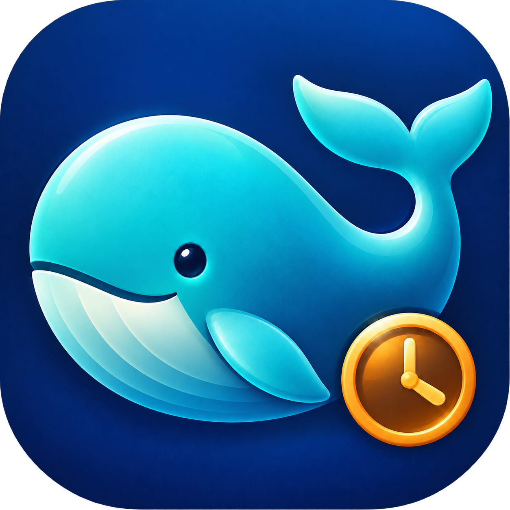
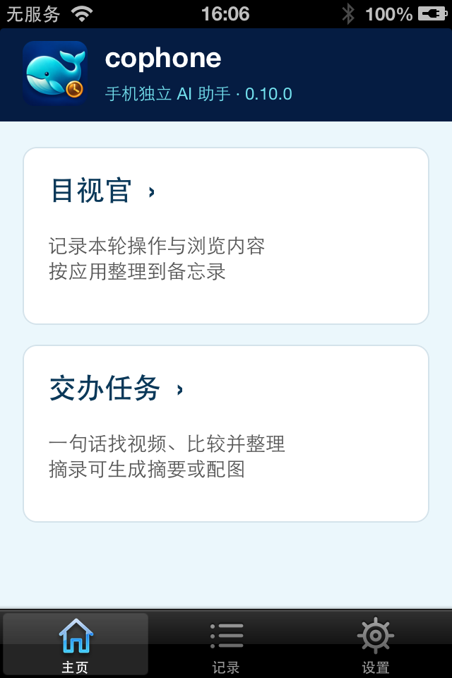
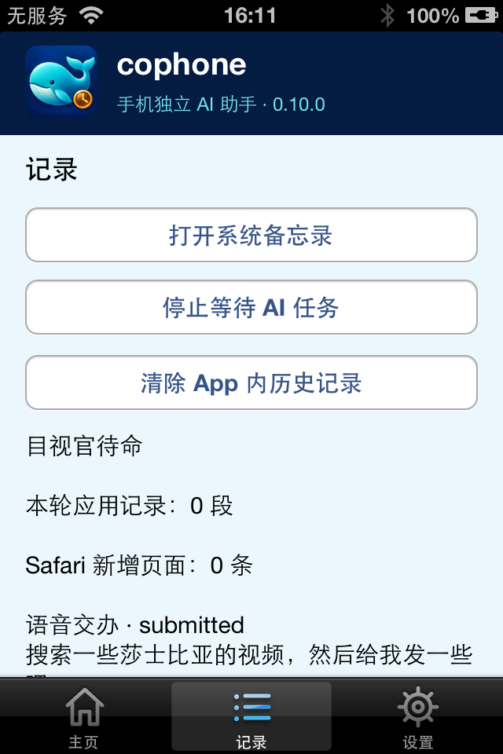
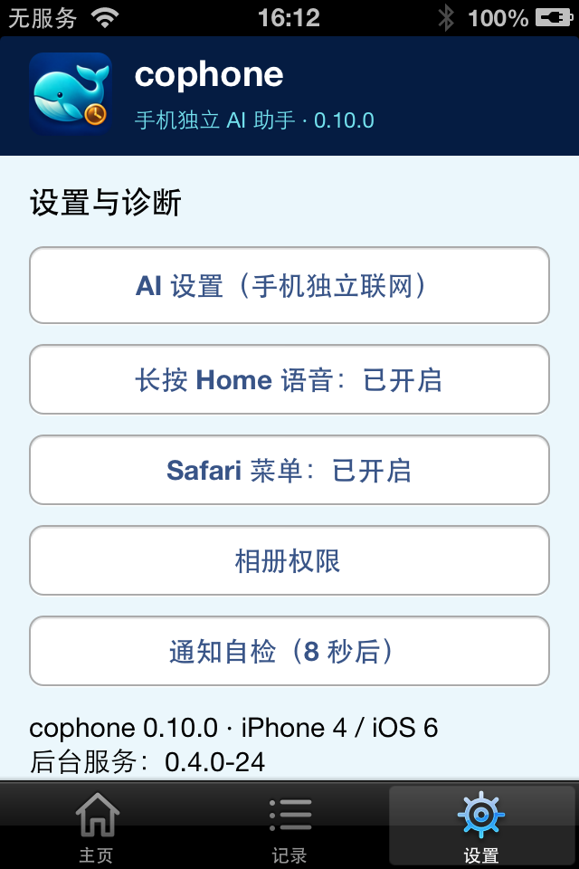
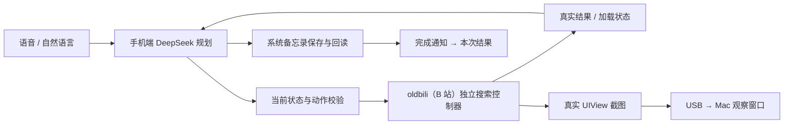

  
  &nbsp;
  

  

<h1 align="center">cophone</h1>

<strong>你继续用手机，交办的事在后台完成。</strong>

iPhone 4 · iOS 6.1.3 · 手机独立联网 · 国内 AI

cophone 是一个运行在已越狱 iPhone 4 上的手机 Agent。你在 Safari 浏览、滚动或打字时，它可以通过 oldbili（适用于旧版 iOS 的第三方 B 站客户端），在真实 App 进程中搜索 B 站视频、读取候选信息、比较推荐，把结果保存到你自己的系统备忘录；也能将选中的网页文字整理成摘要或配图。日常 AI 请求由手机直接发出，Mac 用于部署和可选的执行观察。

**为什么选择 iPhone 4**

iPhone 4 一直是我最喜欢的一部手机。它的尺寸、握持感和单手操作体验，让我觉得手机就该是这样一件轻巧、随身的工具。我也偏爱 iOS 6 拟物化设计的精致感：材质、光影和按钮的细节，让屏幕里的工具带着熟悉的质感与温度。我不喜欢如今动辄“半斤”的大手机，也希望这台喜欢的老设备能继续陪我做新的事情。

我也想借 cophone，向乔帮主时代的产品精神和 Siri 式智能助理的愿景致敬：长按 Home，说出想做的事，助理理解意图、根据实际状态决定下一步，再把办好的结果交到我手里。**我继续用手机，它同时替我办事。** 从我个人的情感出发，这像是在续写乔帮主的一个“遗愿”：让随身的手机成为更懂人、能替人办事的助理。cophone 是我在这台小手机上，为这个愿望迈出的一小步。

| 你来交办 | cophone 来完成 |
| --- | --- |
| **长按 Home，说一句话** | 自然语言找 B 站视频，按真实搜索结果逐轮决策，比较后写入备忘录。 |
| **Safari 选中一段文字** | 在选文菜单确认“整理成摘要 / 整理成图片”，分别保存到备忘录或 cophone 相簿。 |
| **启动目视官** | 按应用分段整理使用时段、可采集的网页摘录及视频信息，生成回顾笔记。 |
| **照常使用手机** | 后台完成后发送通知；点击直达本次笔记正文或单张图片，对应系统 App 显示角标。 |

**应用界面**

以下为 iPhone 4 / iOS 6.1.3 上 cophone 0.10.0 的真机截图。

<table>
  <tr>
    <td align="center"><strong>主页</strong></td>
    <td align="center"><strong>记录</strong></td>
    <td align="center"><strong>设置</strong></td>
  </tr>
  <tr>
    <td></td>
    <td></td>
    <td></td>
  </tr>
</table>

**快速部署**

1. **设备限定：已越狱的 iPhone 4 / iOS 6.1.3**。准备 Cydia Substrate、AppSync、OpenSSH、可用 Wi-Fi；视频任务需自行安装 oldbili（第三方 B 站客户端）**2.0.6 / net.iosipa.oldbili**。
2. 用爱思助手 / iFunBox 安装 `artifacts/ios6/cophone-iOS6-0.10.0-shipping.ipa`。Mac 准备 Python 3，执行 `brew install libimobiledevice libusbmuxd`；连接 USB，双击“安装 cophone 后台.command”。首次加载系统插件需保存内容后手动重载一次桌面。
3. 打开 cophone，在“设置 → AI 设置”**手动保存自己的 DeepSeek / 百炼北京地域 API Key**。发行包不含个人密钥，也不自动导入配置。
4. 保留 cophone 在后台即可使用。Mac 双击“查看 cophone 执行画面.command”观察执行，**无需 Codex**；拔掉 USB 后手机任务仍可运行。详见 [部署教程](docs/DEPLOYMENT.md) 与 [Mac 观察软件说明](Mac%20执行观察使用说明.md)。

**演示一句话：** “找两个三十分钟以内的 AI Agent 入门视频，比较后推荐一个，记到备忘录。”确认后继续在 Safari 滚动、输入，同时观察 Mac 与最终备忘录。观察窗口支持找视频、摘要、配图、目视官；视频面板显示真实后台控制器截图，其余面板显示实际执行数据与返回结果。[1–2 分钟演示流程](docs/DEMO.md)

**技术选型：** Objective-C / UIKit 适配旧系统，mobile 用户 launchd 服务执行任务，Substrate 提供指定 App 的受限语义操作。oldbili 独立 UIView 不接入用户窗口，避免争用焦点和键盘；DeepSeek 负责规划 / 摘要，千问负责转写 / 生图；保存后独立回读才报告成功。[一页技术选型 PDF](cophone-技术选型说明.pdf) · [实现原理与取舍](docs/ARCHITECTURE.md)

**构建与配置：** 使用 Xcode clang、ld-classic 和包含 armv7 的旧 SDK；`IOS_LEGACY_SDK=/path/to/iPhoneOS9.3.sdk python3 ios6/build.py`，随后构建各组件。运行时密钥保存在手机私有 Library，不读取 Mac 环境变量。部署支持 `--udid`，观察窗口支持 `--port`。[构建与检查](docs/BUILD.md)

**已验证与边界：** 语音交办、后台视频比较、选文摘要 / 配图、目视官、结果直达及目标 App 角标均已真机验证。记录页可清除 App 内历史，保留系统结果与 API 设置。当前适配指定 App，不是任意 App 的通用视觉点击 Agent；视频比较依据标题、时长、UP 主和可用简介，不观看完整视频，不支持收藏 / 登录；其他 App 内容采集取决于适配能力。执行数据面板不冒充 App 实时画面。[验收与已知问题](docs/STATUS.md)
