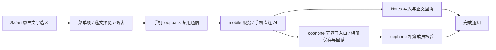

# cophone Safari 选文菜单

配套 App **0.7.3**、后台服务 **0.4.0-10**、菜单插件 **0.1.1**。仅越狱 iPhone4 / iOS6，依赖已安装的 Cydia Substrate。菜单插件只在 `com.apple.mobilesafari` 加载，不注入 SpringBoard；不是普通 IPA 能提供的系统菜单权限。

## 一次安装

1. 爱思助手 / iFunBox 覆盖安装 `artifacts/ios6/cophone-iOS6-0.7.3.ipa`，打开一次，保留原有密钥和记录。
2. 双击根目录 **安装 iPhone 系统菜单.command**，一次安装/更新后台服务和 Safari 菜单 DEB；SSH 密码只在本机终端输入，不保存。也可在手机 iFile 依次安装两个 DEB。不自动安装 IPA、不重启桌面、不强退 Safari。
3. 保存 Safari 未提交的输入，在多任务栏退出并重新打开 Safari。设置页可开关 Safari 菜单，开关无需重开 Safari。主页“启动”也会开启菜单并开始一轮使用回顾；回顾结束后，只要 cophone 仍在后台菜单就可用。手动杀掉 cophone 后约2秒内菜单隐藏，后台拒绝新任务；重新打开应用恢复，开关仍可在设置关闭。

之后只需要手机和 Wi-Fi，无需 USB、电脑或 Codex。

## 日常使用

网页正文长按选择 → 泡泡菜单（可能需要右箭头下一页）→ **整理成图片 / 整理成摘要** → 核对选文预览 → **开始整理**。取消不发请求，不改剪贴板。仅支持1–2000字非编辑正文，不在密码框、地址栏、输入框显示。

后台接受后通过 cophone 发“正在整理”本地通知。摘要写入系统备忘录；配图保存 cophone 相簿。真实回读后再发完成通知，失败会提示到记录页查看；不需要先回桌面，也不自动切换你的应用。iOS 通知样式由系统设置决定，不把提交通知当作实际可见。

照片权限由 **cophone → 设置 → 相册权限** 在前台请求。Safari 不申请或冒用照片权限；它只提交确认的文字。图片结果到达后，mobile 服务执行已安装 cophone 自己的二进制 `--photo-worker` 入口，不调用 UIApplicationMain，不创建窗口。该入口必须确认真实 bundle ID 和已获照片授权，复用同一相册保存/回读逻辑；没有授权就停止，不绕过 TCC。无界面入口有90秒期限，0.7.3已通过Safari前台实际生成/保存/像素与相簿回读验收。用户可在 GUI 接续已有结果，不重新生图。

## 实现链路

Substrate `MSHookMessageEx` 挂接 Safari 的 `UIWebDocumentView` / `UIWebBrowserView` 菜单能力查询与 UIMenuController 的自定义菜单项；原系统操作转发原实现，保留其他插件的菜单项。当前选区使用 iOS6 真机核对的 `selectedDOMRange`，仅点击自定义操作时转为文本，不轮询网页正文，不调用拷贝，不执行网页 JavaScript。

Safari 沙盒不能直接发现 cophone 的容器，0.1.0 的文件方案未通过真机；0.1.1 改用手机127.0.0.1:18769。服务生成随机128位能力票据，通过两个Darwin通知状态交给原生插件；插件不读API Key或App文件。HTTP严格验证字面Host、Bearer票据、方法/路径、JSON类型、明确consent和选文长度，拒绝Origin、重复长度、分块与多余数据；不开放CORS或外部地址。网页无法读取Darwin状态，同机原生代码仍是信任边界，不能将它描述为进程身份鉴权。

只有确认提交才 POST /v1/enqueue；GET /v1/status 仅返回启用/照片就绪元数据。服务将选文送入同一TaskInbox，提交锁避免覆盖进行中任务。相册跨进程锁、检查点和回调代次防止重复插入或过期回调写回。桌面App仍支持有限后台时间，Safari入口由服务和无界面照片进程完成，不依赖Safari后台驻留。

构建：`python3 ios6/build.py` → `python3 ios6/review/build_service.py`、`python3 ios6/menu/build_menu.py`。检查：`verify_build.py`、`review/verify_service.py`、`menu/verify_menu.py`、`tests/test_inbox.py`、`tests/test_album.py`。真机结果见 [验证记录](../../docs/VALIDATION.md)，构建或菜单出现不能代替真实保存成功。

[Apple 自定义菜单](https://developer.apple.com/documentation/uikit/uimenuitem?language=objc) · [Substrate 挂接接口](https://www.cydiasubstrate.com/api/c/MSHookMessageEx/) · [Safari 过滤范围](https://www.cydiasubstrate.com/inject/darwin/)

## 应用退出即下线

cophone GUI 持有 agent-presence.lock 的内核文件锁，普通挂起不会释放，进程结束自动释放；不靠后台定时心跳猜测，也不依赖强杀时不会执行的退出回调。每次 GUI 启动生成新会话，任务绑定会话；无界面照片入口不持有在线锁，不能让助手自行保活。后台不再采集、提交、查询或保存新结果，进行中的网络连接取消，回顾暂停，旧任务不会自动交给新会话。已发出的云端请求和已开始的系统相册保存不能保证撤回；已保存结果保留，未确认提交不自动重试。服务保留最小就绪检查以响应重新上线。
